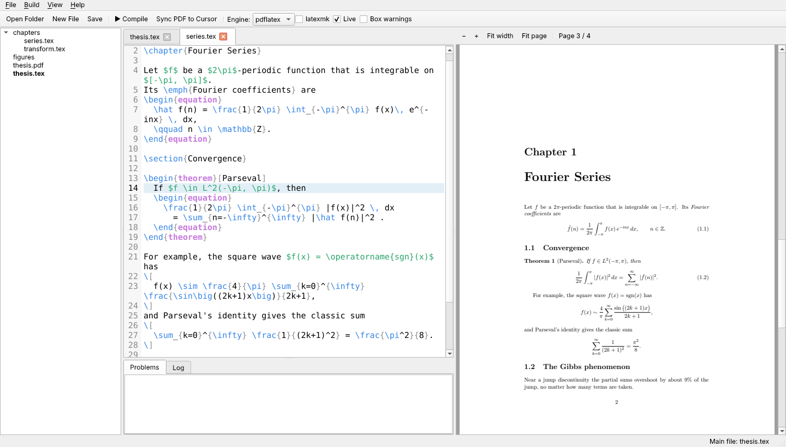

# QTeX

A lightweight LaTeX editor for whole projects, with a live PDF preview. File tree on the left, tabbed editor in the middle, the PDF on the right. It compiles with the TeX Live or MiKTeX already on your computer.



## Download

Get the latest Windows version from the **[Releases page](../../releases/latest)**:

- **`QTeX-Setup-<version>.exe`**: installer. No admin rights needed. Adds a Start menu entry and an uninstaller, plus optional *Open with → QTeX* for `.tex` files and *Open in QTeX* on folders.
- **`QTeX-<version>-portable.zip`**: no install needed. Unzip it anywhere and run `QTeX.exe`.

You also need a TeX distribution: [MiKTeX](https://miktex.org/download) or [TeX Live](https://tug.org/texlive/).

**Updates:** installed copies check for a new release each time they open and can update themselves in a few clicks: QTeX downloads the new installer, verifies it, installs it and reopens. Portable copies tell you about new versions and open the download page. You can check by hand with *Help → Check for Updates…* or turn the startup check off in the same menu.

Windows may say *"Windows protected your PC"* the first time, because the app isn't code-signed. Click **More info → Run anyway**.

## Features

- **Whole projects.** Open a folder and the main file is found automatically. Chapters in subfolders, `\input`/`\include`, and `% !TEX root = ../main.tex` comments all work.
- **Live preview.** The PDF recompiles shortly after you stop typing, in any file, and keeps its scroll position.
- **No Perl or latexmk needed.** The built-in build runs LaTeX, BibTeX or Biber, makeindex, and reruns LaTeX until references settle. latexmk is optional.
- **Problems panel.** Errors and warnings with the file and line they came from. Click one to jump there.
- **SyncTeX, both ways.** `Ctrl+J` shows where the cursor's line is in the PDF. Turn on *Highlight source* and point at the PDF to see the matching source line highlighted, or `Ctrl+click` to jump there.
- Light and dark themes; pdflatex, xelatex or lualatex; syntax highlighting; line numbers; comment toggling; file management in the tree; open tabs restored per project.

## Using QTeX

- **Open Folder** (`Ctrl+Shift+O`) opens a project. The tree shows every file except build by-products (`.aux`, `.log`, `.synctex.gz`, …).
- **Main file**: the document that gets compiled, shown in **bold** in the tree and in the status bar. It's detected automatically (`main.tex`, otherwise a `.tex` file with `\documentclass` and `\begin{document}`). To change it, right-click a file → *Set as Main File*. It's remembered per project.
- **`% !TEX root = ../main.tex`** at the top of a chapter is honoured: opening that chapter opens its whole project. New `.tex` files get this line automatically.
- **Compile** (`Ctrl+Enter`) saves every modified tab and always builds the main file, whichever tab you're in. With *Live* on, it recompiles 1.5 s after you stop typing.
- **Problems** lists errors and warnings with their file (`chapters/intro.tex:10`). Click one to open that file at that line. Error lines are also marked red in the gutter. Tick *Box warnings* to include over/underfull boxes.
- **PDF ↔ source.** *Sync PDF to Cursor* (`Ctrl+J`) scrolls the PDF to the cursor's line and outlines it. The **Highlight source** button on the PDF toolbar highlights the source line under your mouse as you move over the PDF. `Ctrl+click` in the PDF jumps to that line. Both work across all files in the project.
- **PDF navigation.** Mouse wheel scrolls, `Shift` + wheel scrolls sideways (when zoomed in), `Ctrl` + wheel zooms.
- **Search** with `Ctrl+F`: all matches are highlighted; `Enter`/`Shift+Enter` (or `F3`/`Shift+F3`) step through them. Options for match case and whole words. `Esc` closes the bar.
- **More room:** hide the project tree with `Ctrl+B` and the Problems/Log panel with `Ctrl+Shift+M` (or its ✕). Both stay hidden until you bring them back.
- **Light or dark.** *View → Theme* switches between Light, Dark and System (follows Windows). The choice is remembered.
- **Right-click in the tree** to create files and folders, rename, delete (to the recycle bin), copy a path relative to the main file (for `\input`/`\includegraphics`), or show it in Explorer. Images and other non-text files open in your default app.
- Open tabs, engine and main file are restored when you reopen a project. *File → Recent Projects* lists the last ten.
- Files changed by another program reload automatically if you have no unsaved edits in them.

### Building documents

QTeX's own build does what latexmk does: it runs LaTeX, then BibTeX or Biber when citations or `.bib` files change, makeindex when there's an index, and reruns LaTeX until references and the table of contents settle (up to 5 runs). An unchanged document recompiles in a single run.

Tick **latexmk** in the toolbar to use latexmk instead. MiKTeX's latexmk needs Perl (e.g. Strawberry Perl). If Perl is missing, QTeX notices, unticks the box and uses its own build.

### Shortcuts

| Action | Keys |
|---|---|
| Compile | `Ctrl+Enter` |
| Sync PDF to cursor | `Ctrl+J` |
| Jump from PDF to source | `Ctrl+click` in the PDF |
| Scroll PDF sideways / zoom PDF | `Shift` + wheel / `Ctrl` + wheel |
| Open folder / file | `Ctrl+Shift+O` / `Ctrl+O` |
| New file | `Ctrl+N` |
| Save / Save all | `Ctrl+S` / `Ctrl+Alt+S` |
| Close tab / next / previous | `Ctrl+W` / `Ctrl+PgDown` / `Ctrl+PgUp` |
| Toggle comment | `Ctrl+/` |
| Find / next / previous | `Ctrl+F` / `F3` (or `Enter`) / `Shift+F3` (or `Shift+Enter`) |
| Show/hide project tree | `Ctrl+B` |
| Show/hide Problems panel | `Ctrl+Shift+M` |
| List all shortcuts | `F1` (Help → Keyboard Shortcuts) |

## Development

### Run from source

```powershell
python -m pip install PySide6
python texeditor.py                      # reopens your last project (or shows a start screen)
python texeditor.py C:\path\to\project   # opens a project folder
python texeditor.py chapters\intro.tex   # opens a file and its project
```

On Windows use `python` (or `py`), not `python3`, so it matches the `pip` you installed with. The whole app is the single file `texeditor.py`.

### Build the .exe and installer locally

1. *(Once, for the installer)* Install Inno Setup 6: `winget install JRSoftware.InnoSetup`. Without it you still get the `.exe` and the portable zip.
2. Double-click **`build.bat`**. The first run takes a few minutes because it creates a separate build environment (`.venv-build`) and leaves your normal Python alone.
3. Results:
   - `dist\QTeX\QTeX.exe`: the app. Keep the whole `QTeX` folder together.
   - `installer\QTeX-<version>-portable.zip`
   - `installer\QTeX-Setup-<version>.exe`

| File | What it does |
|---|---|
| `build.bat` / `build.ps1` | Build script: PyInstaller, portable zip, Inno Setup installer |
| `qtex.spec` | PyInstaller recipe (which Qt parts to include) |
| `installer.iss` | Inno Setup installer script |
| `requirements-build.txt` | Exact packages used for builds |
| `release.bat` / `release.ps1` | Makes a release (see below) |
| `.github/workflows/release.yml` | Builds and publishes releases on GitHub |

### Make a release

Releases are built by GitHub Actions on Windows, so you don't have to upload anything yourself.

1. As you work, note changes under `## [Unreleased]` in **`CHANGELOG.md`** and commit them.
2. Run **`release.bat 1.2.0`** (or double-click it and type the version). It moves the Unreleased notes into a `1.2.0` section, sets `APP_VERSION` in `texeditor.py`, commits, tags `v1.2.0` and pushes.
3. GitHub builds the installer and portable zip and publishes the release, with that version's changelog section as the release notes. This takes about 5 minutes; follow it on the repository's **Actions** tab.

To test a build without releasing, open **Actions → Build and release → Run workflow**. The files are attached to that run.

Users upgrade by running the new installer; it replaces the old version and keeps their settings.

## License

Copyright © 2026 André Lopes.

QTeX is free software: you can redistribute it and/or modify it under the terms of the [GNU General Public License v3](LICENSE) or (at your option) any later version. It comes with no warranty.

The Windows builds include Qt and PySide6 (LGPLv3), Python and the PyInstaller bootloader. See [THIRD-PARTY-NOTICES.md](THIRD-PARTY-NOTICES.md).
